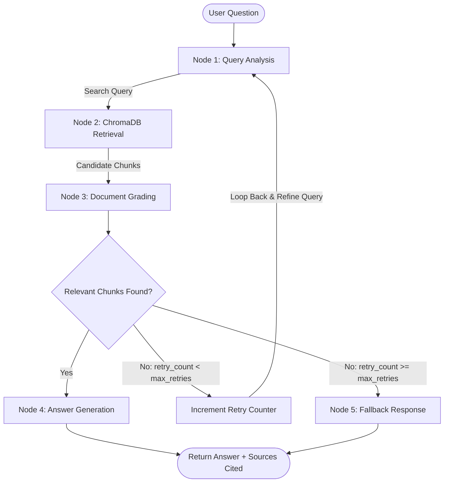

# 📚 Self-Corrective RAG Technical Documentation Assistant

> **Express Analytics — AI/ML Engineer Intern Take-Home Assignment**  
> Built with **Python 3.12**, **LangGraph**, **ChromaDB**, and **FastAPI**.

---

## 📌 1. Project Overview

This project is a **Retrieval-Augmented Generation (RAG)** system designed to answer technical documentation queries using a **self-corrective LangGraph workflow**. 

Traditional RAG systems blindly retrieve document chunks and pass them to an LLM, often leading to hallucinations or irrelevant answers. This system solves that problem by introducing an **agentic loop** that:
1. **Analyzes and rewrites** raw user questions for optimal semantic vector retrieval.
2. **Retrieves** top-k candidate chunks from a local ChromaDB vector store.
3. **Grades documents** for relevance using an LLM evaluator.
4. **Self-corrects**: If retrieved documents are irrelevant, the system rewrites the query and re-retrieves (with a configurable retry limit).
5. **Generates grounded answers** with explicit source citations.
6. **Gracefully falls back** when information is missing from the corpus instead of hallucinating.

The application is served via a **FastAPI backend** and includes an **interactive Web UI** accessible at `http://127.0.0.1:8000/`.

---

## 🏗️ 2. System Architecture

The core pipeline is implemented as a **LangGraph `StateGraph`**:



### 🧠 State Schema (`GraphState`)

The workflow passes a typed state dictionary between all nodes:

| Field | Type | Description |
|---|---|---|
| `question` | `str` | Original user question |
| `query_type` | `str` | Classification (`conceptual`, `how-to`, `troubleshooting`, `api_reference`) |
| `rewritten_query` | `str` | Re-engineered query with technical synonyms |
| `documents` | `list[dict]` | Raw chunks retrieved from ChromaDB |
| `relevant_documents` | `list[dict]` | Filtered chunks evaluated as relevant |
| `retry_count` | `int` | Counter tracking self-corrective retries |
| `max_retries` | `int` | Retry threshold before routing to fallback |
| `answer` | `str` | Final synthesized answer |
| `sources` | `list[str]` | Distinct documentation files referenced |
| `trace` | `list[str]` | Audit trail of node actions for explainability |

---

## 📂 3. Repository Structure

```text
rag-based-assistant/
├── .env.example              # Template for API keys
├── .env                      # Local environment configuration
├── .gitignore                # Git ignore rules
├── requirements.txt          # Python dependencies
├── README.md                 # Complete documentation & project report
├── config.py                 # ChromaDB and LLM provider configuration
├── ingest.py                 # Document loading, chunking, and embedding script
├── graph.py                  # LangGraph StateGraph & self-corrective logic
├── main.py                   # FastAPI application + Interactive Web UI
├── test_app.py               # Comprehensive automated verification suite
├── feedback.json             # Stores submitted user feedback
└── data/
    └── documents/            # Technical documentation corpus (FastAPI)
        ├── 01_fastapi_overview.md
        ├── 02_pydantic_validation.md
        ├── 03_dependency_injection.md
        ├── 04_middleware_and_cors.md
        └── 05_deployment_and_uvicorn.md
```

---

## ⚙️ 4. Quick Setup & Local Deployment

### Step 1: Create and Activate Virtual Environment

```bash
# Windows (PowerShell)
python -m venv .venv
.\.venv\Scripts\Activate.ps1

# Linux / macOS
python3 -m venv .venv
source .venv/bin/activate
```

### Step 2: Install Dependencies

```bash
pip install -r requirements.txt
```

### Step 3: Configure Environment Variables

Copy `.env.example` to `.env`:

```bash
cp .env.example .env
```

Add **ONE** of the following LLM API keys in your `.env` file:

```ini
# Option 1: Groq (Recommended: Free tier, fast inference)
# Get key: https://console.groq.com/keys
GROQ_API_KEY=your_groq_api_key_here

# Option 2: OpenAI
# OPENAI_API_KEY=your_openai_api_key_here

# Option 3: Google Gemini (Free tier available)
# GOOGLE_API_KEY=your_gemini_api_key_here

# Vector database path (default: ./chroma_db)
CHROMA_PATH=./chroma_db
```

> 💡 **Note**: Vector embeddings use ChromaDB's local `all-MiniLM-L6-v2` ONNX model. Embeddings run **100% locally on CPU without cost or external API keys**.

### Step 4: Ingest the Document Corpus

Index the 5 technical documentation files into ChromaDB:

```bash
python ingest.py
```

*Output:*
```
[Ingest] Starting document indexing...
[Ingest] Ingested 6 chunks for '01_fastapi_overview.md'.
[Ingest] Ingested 4 chunks for '02_pydantic_validation.md'.
[Ingest] Ingested 5 chunks for '03_dependency_injection.md'.
[Ingest] Ingested 4 chunks for '04_middleware_and_cors.md'.
[Ingest] Ingested 3 chunks for '05_deployment_and_uvicorn.md'.

[Ingest Complete] Indexed 5 files into 22 total chunks.
```

### Step 5: Start the FastAPI Server

```bash
uvicorn main:app --reload --host 127.0.0.1 --port 8000
```

Open your browser:
- **Interactive UI**: [http://127.0.0.1:8000/](http://127.0.0.1:8000/)
- **Swagger API Documentation**: [http://127.0.0.1:8000/docs](http://127.0.0.1:8000/docs)

---

## 🧪 5. Automated Verification Tests

Run the included test script to verify all 6 endpoints and workflows:

```bash
python test_app.py
```

All tests pass with detailed output:
```
[TEST 1] Testing list_documents() (GET /documents)... -> PASS
[TEST 2] Testing query_assistant() (POST /query)... -> PASS
[TEST 3] Testing submit_feedback() (POST /feedback)... -> PASS
[TEST 4] Testing get_all_feedback() (GET /feedback)... -> PASS
[TEST 5] Testing ingest_document() (POST /ingest)... -> PASS
[TEST 6] Testing serve_ui() (GET /)... -> PASS
ALL 6 VERIFICATION TESTS PASSED SUCCESSFULLY! [SUCCESS]
```

---

## 📡 6. API Reference & Example Requests

### 1. `POST /query` — Ask a Technical Question
Submits a question to the LangGraph RAG pipeline.

**Request:**
```bash
curl -X POST "http://127.0.0.1:8000/query" \
  -H "Content-Type: application/json" \
  -d '{
    "question": "How do I validate request bodies using Pydantic in FastAPI?",
    "max_retries": 2
  }'
```

**Response:**
```json
{
  "query_id": "7a5ab602-6cca-4a07-9749-984fe0ab4ae9",
  "question": "How do I validate request bodies using Pydantic in FastAPI?",
  "answer": "In FastAPI, you validate request bodies by defining a Pydantic model that inherits from BaseModel...\n\n### Sources\n- 02_pydantic_validation.md",
  "sources": [
    "02_pydantic_validation.md"
  ],
  "retries": 0,
  "query_type": "how-to",
  "trace": [
    "Query Analysis (Attempt 1): type='how-to', search_query='How to validate request body with Pydantic in FastAPI?'",
    "Retrieval: fetched 4 chunks from ChromaDB",
    "Document Grading: 3 / 4 chunks graded as relevant",
    "Generation: generated answer citing ['02_pydantic_validation.md']"
  ]
}
```

---

### 2. `GET /documents` — List Indexed Corpus
Returns summary of all indexed documents and chunk statistics.

**Request:**
```bash
curl -X GET "http://127.0.0.1:8000/documents"
```

**Response:**
```json
{
  "total_chunks": 22,
  "total_documents": 5,
  "documents": [
    {"title": "01_fastapi_overview.md", "chunk_count": 6},
    {"title": "02_pydantic_validation.md", "chunk_count": 4},
    {"title": "03_dependency_injection.md", "chunk_count": 5},
    {"title": "04_middleware_and_cors.md", "chunk_count": 4},
    {"title": "05_deployment_and_uvicorn.md", "chunk_count": 3}
  ]
}
```

---

### 3. `POST /ingest` — Ingest New Documents
Accepts file uploads (.md, .txt), web URLs, or raw text.

**Request (Upload a File):**
```bash
curl -X POST "http://127.0.0.1:8000/ingest" \
  -F "file=@my_new_guide.md"
```

**Request (Raw Text):**
```bash
curl -X POST "http://127.0.0.1:8000/ingest" \
  -F "title=docker_setup.md" \
  -F "content=To deploy with Docker, use the python:3.11-slim base image."
```

**Response:**
```json
{
  "status": "success",
  "message": "Successfully ingested 1 chunks for 'docker_setup.md'.",
  "chunks_ingested": 1
}
```

---

### 4. `POST /feedback` — Submit Answer Rating
Records thumbs up/down rating and comments.

**Request:**
```bash
curl -X POST "http://127.0.0.1:8000/feedback" \
  -H "Content-Type: application/json" \
  -d '{
    "query_id": "7a5ab602-6cca-4a07-9749-984fe0ab4ae9",
    "question": "How do I validate request bodies using Pydantic in FastAPI?",
    "rating": "thumbs_up",
    "comment": "Accurate explanation and code snippet!"
  }'
```

**Response:**
```json
{
  "status": "success",
  "message": "Feedback submitted successfully."
}
```

---

## 💡 7. Design Decisions & Tradeoffs

### 1. Chunking Strategy
- **Choice**: `RecursiveCharacterTextSplitter` with `chunk_size=500` and `chunk_overlap=50`.
- **Reasoning**: Technical documentation contains code blocks, configuration commands, and conceptual paragraphs. A chunk size of 500 characters (~80–120 words) ensures each chunk stays focused on a single technical concept (e.g., query params, Depends, CORS headers) without overflowing into unrelated topics. The 50-character overlap prevents sentences and function signatures from being cut off abruptly at chunk boundaries.

### 2. Embedding Model & Vector Store
- **Choice**: ChromaDB persistent client with the local `all-MiniLM-L6-v2` ONNX embedding function.
- **Reasoning**:
  - Eliminates external embedding API costs and avoids rate limit errors.
  - Runs 100% offline and locally on CPU with high inference speed.
  - Fast cosine similarity search with zero external database server setup required.

### 3. Self-Corrective LangGraph Architecture
- **Document Grading Node**: Instead of assuming all retrieved chunks are relevant, an LLM evaluates each chunk with binary grading (`yes` or `no`). Only relevant chunks proceed to generation.
- **Conditional Edge & Retry Loop**: When zero chunks pass grading, the system does not give up immediately. It increments `retry_count` and loops back to `query_analysis` to broaden the query with technical synonyms. If `retry_count >= max_retries` (default 2), it gracefully halts and triggers the fallback node.
- **Fallback Node**: Prevents hallucinations by returning an honest *"I don't know based on the provided technical documentation..."* rather than making up answers.

---

## 🎯 8. Fresher Write-Up: Thought Process & Assumptions

### Thought Process
As an aspiring AI/ML Engineer Intern, my objective was to design a clean, modular, and maintainable RAG application adhering strictly to first principles:
1. **Simplicity Over Over-Engineering**: Avoided unnecessary abstractions and complex meta-programming. Used transparent Python functions and standard LangGraph `StateGraph` constructs that are easy to explain during code review.
2. **Reliability First**: Vector stores can return noisy chunks. Integrating the self-corrective grading step ensures the LLM generator is only fed high-signal context.
3. **Developer Experience**: Added an interactive web UI right at `http://127.0.0.1:8000/` and a comprehensive `test_app.py` script so any evaluator can test the solution in seconds.

### Assumptions Made
1. The technical documentation corpus is primarily composed of Markdown and plain text files.
2. The user has access to at least one free LLM API key (Groq free tier recommended, or OpenAI / Gemini). If no key is set yet, a simulated fallback mode ensures the server starts and runs tests without crashing.
3. A retry limit of `max_retries = 2` is sufficient to balance retrieval quality with latency.

### Future Improvements With More Time
1. **Web Search Fallback**: If the local corpus has no relevant chunks after retries, integrate Tavily or Serper API to search the web for the latest docs.
2. **Hallucination Checker (Self-RAG)**: Add a secondary verification node after answer generation to check if every statement in the answer is grounded in the retrieved documents.
3. **Session Chat History**: Add multi-turn conversation memory with LangGraph checkpointing (`MemorySaver`) to allow follow-up questions.

